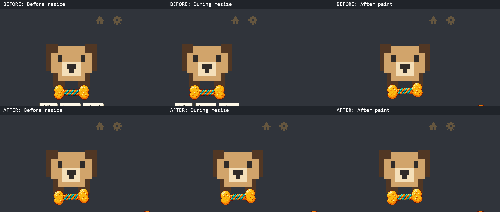
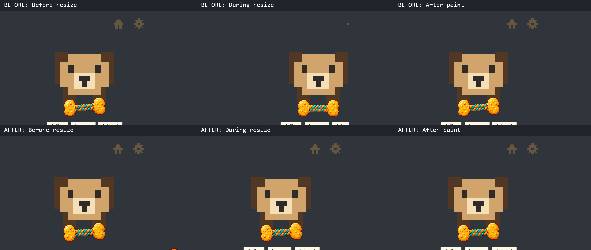

# Floating toy frame regression

Captured on Windows on November 23, 2026. Fix branch: `codex/floating-toy-frame-fix`, based on `db3012c` from the window-layout worktree. Other worktrees' source changes were left intact.

## Reproduced before editing

In the native floating app, repeatedly click the bone to open and close the quest board. Capture the rendered desktop continuously, rather than taking a screenshot after awaiting the click. Home/Settings and the dog move together for a brief frame.

An initial 24-transition recording captured 26 shifted frames. A later clean-background baseline captured 297 frames over eight transitions: four opening frames shifted left 127 physical pixels, four closing frames shifted right 127 pixels. Every transition reproduced the blink. The dog returned to its original position immediately afterward. Capture samples are not necessarily unique monitor refreshes.

The native window width alternated between 467 and 722 physical pixels. Its left edge alternated between 1000 and 873. The OS scale was 1.5 and the webview CSS-to-physical ratio was approximately 1.88. Grouping native move/size calls did not synchronize the window move with the webview's new painted surface.

## Fix

Reserve the 384 CSS pixel board width in both collapsed and expanded floating mode. Keep fitting the height to the content. The native window no longer changes its width or left edge when opening/closing the board, so an older painted surface cannot jump horizontally. The CSS canvas and native minimum width must agree.

The dog, centered compact control strip, toy, and quest board keep their visible dimensions and center alignment. Collapsed mode has wider transparent side margins that intercept desktop clicks, consistent with the existing absence of selective click-through. This is a deliberate tradeoff to remove the compositor race without another window or a platform-specific timing delay.

## Native verification

| Recording | Transitions | Captured frames | Horizontal shifts |
| --- | ---: | ---: | ---: |
| Clean baseline | 8 | 297 | 8 |
| Fixed, muted, developer controls visible | 40 | 1,385 | 0 |
| Fixed detail recording | 8 | 297 | 0 |
| Fixed, sound enabled, developer controls hidden | 16 | 570 | 0 |

All 2,252 fixed frames contained the dog at the same capture-relative horizontal bounds, [367, 534]. Native width stayed 722 physical pixels and native left edge stayed 1000 throughout each fixed recording. The two baseline stable bounds differ from the fixed bounds by one physical pixel because of integer rounding at this zoom. No dog disappearance was detected. See [measurements](measurements.json).

The screenshots below are consecutive baseline frame samples and matching fixed transition samples. Every column uses the same screen-space crop; no dog or icon was repositioned in the evidence. A plain background avoids capturing unrelated app content. Captions were added above each crop.

## Build and repeat

`npm run check` passed all 23 tests, source-size checks, TypeScript, and the frontend production build. Native compilation passed with `npm run tauri build -- --debug --no-bundle --config .tools/native-test.json`.

The ignored test config overrides only the application identifier to `com.inova.frame-test` and the main window title to `Inova Frame Test`; its remaining window properties match tauri.conf.json. Use fictional adopted-dog data in that isolated profile. Start the compiled executable, enter floating mode, and click the toy repeatedly with a fixed screen-space frame recorder running. Test muted and sound-enabled settings, and repeat after restart. This recording used Windows GDI BitBlt to capture at roughly 75 samples/second, logging native bounds and the original placeholder dog's solid tan pixel bounds per sample.

Native Windows debug compilation and the focused transitions were verified. macOS runtime, a new release build, dragging, audible playback, monitor-edge resizing, and arbitrary zoom changes were not tested in this fix. The stable-width rule is platform-independent; that does not establish Mac compositor behavior.
